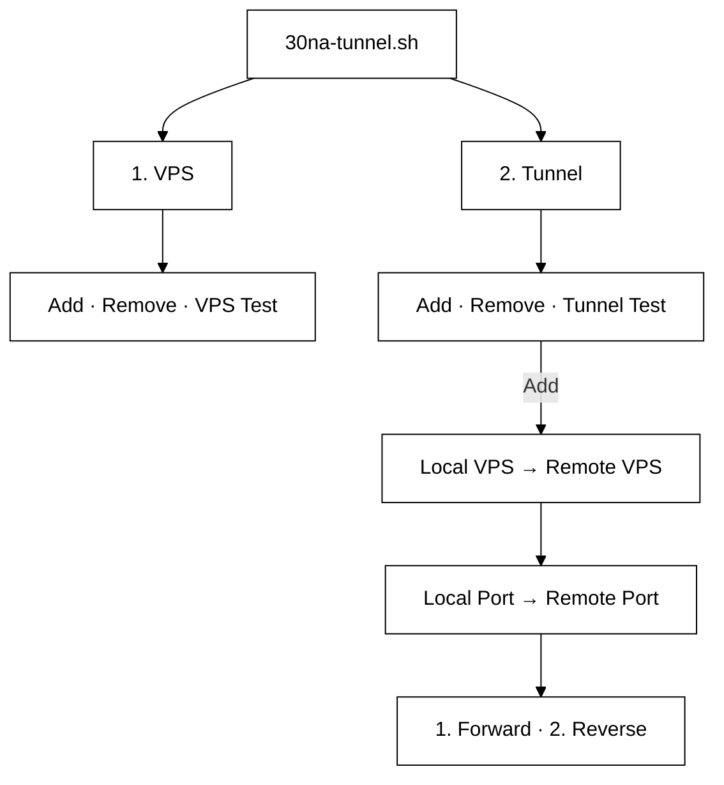

# 30nA-TUNNEL

نسخهٔ آزمایشی **2.0.0-rc.1** برای تست پذیرش کاربر، پیش از انتشار اولین Release.

مدیریت تونل‌های TCP با OpenSSH و systemd از یک ترمینال Ubuntu. هر تونل دو VPS
مشخص دارد. **Local VPS** پورت ورودی کاربران را نگه می‌دارد و **Remote VPS**
میزبان سرویس مقصد است.

| Mode | آغازکنندهٔ اتصال SSH | مسیر ترافیک کاربر |
|---|---|---|
| Forward | Local VPS | Local Port → Remote Port |
| Reverse | Remote VPS | Local Port → Remote Port |

## نصب و اجرا

روی VPS مدیریتی با کاربر root اجرا کن. Ubuntu 22.04 و 24.04 هدف این نسخه هستند.
فایل ZIP را ابتدا در مسیر `/root/30na-SSH-Backup.zip` قرار بده.

```bash
clear
bash <(curl --http1.1 -fsSL --retry 3 https://raw.githubusercontent.com/sina1991/30nA-Tunnel/main/install.sh)
```

در اولین اجرا nano با این متن باز می‌شود. فقط مقدار داخل کوتیشن را جایگزین کن
و با Ctrl+X، سپس Y و Enter ذخیره کن.

```text
zip-pass="Input Here"
```

رمز در فایل متنی `/root/.30na-tunnel-passwords` با مجوز 600 باقی می‌ماند.
نصاب فایل را به‌صورت داده می‌خواند. در اجراهای بعدی رمز از همین فایل استفاده
می‌شود. برای تغییر رمز، `nano /root/.30na-tunnel-passwords` را اجرا کن.
رمز ZIP در خروجی ترمینال یا آرگومان 7-Zip قرار نمی‌گیرد.

نصاب پیش‌نیازها را نصب می‌کند، جفت‌کلید ZIP را اعتبارسنجی می‌کند، کلیدهای
موجودِ یکسان را نگه می‌دارد و کلید عمومی را یک‌بار ثبت می‌کند. کلید موجود متفاوت
یا ناقص باعث توقف بازیابی می‌شود. اگر خود کلید SSH passphrase داشته باشد،
OpenSSH برای بازکردن آن می‌تواند passphrase درخواست کند.

اجرای بعدی داشبورد:

```bash
clear
30na-tunnel
```

مسیر مستقیم برنامه `/opt/tunnel-manager/30na-tunnel.sh` است.
فایل `tunnel.sh` قدیمی نیز همین برنامه را باز می‌کند.
کلید مدیریت بدون passphrase روی VPS مدیریتی ساخته می‌شود. فقط کلید عمومی آن
روی VPSهای ثبت‌شده قرار می‌گیرد. برای هر تونل یک کلید و حساب محدودِ مخصوص همان
تونل به‌طور خودکار ساخته می‌شود.

## صفحه اصلی و منو

صفحه با هر انتخاب پاک می‌شود. وضعیت VPSها، DNS و تونل‌ها بالای همهٔ منوها
نمایش داده می‌شود. خروجی در ترمینال رنگی است. `NO_COLOR=1` رنگ‌ها را خاموش
می‌کند. DNS Check نتیجهٔ resolve آدرس VPS است. ستون TEST زمان آخرین تست را
دارد و STATE وضعیت فعلی سرویس را نشان می‌دهد.

```text
30nA-TUNNEL 2.0.0-rc.1
vps-56001 · 91.216.217.244 · 14:30

VPS
ID   HOST                  SSH       DNS CHECK
1    91.216.217.244         LOCAL     OK (14:30)
2    uk5.30na.top           OK        OK (14:30)
3    gr02.30na.top          OK        OK (14:30)

TUNNELS
ID   MODE      LOCAL VPS:PORT          REMOTE VPS:PORT      STATE   TEST
1    Forward   91.216.217.244:443       uk5.30na.top:443     UP      OK ...
4    Reverse   91.216.217.244:6677      gr02.30na.top:443    UP      OK ...

1. VPS
2. Tunnel
0. Exit
```

شناسه‌های این مثال نمونه‌اند. همیشه از شماره‌های جدول برنامه استفاده کن.



### VPS

```text
1. Add New VPS
2. Remove VPS
3. VPS Test
0. Back
```

**Add New VPS** دامنه یا IP و پورت SSH را می‌گیرد. پیش‌فرض پورت SSH برابر 22
است. برای بار اول، تأیید هویت سرور یا احراز هویت اولیه ممکن است لازم شود.
پروژه با همان revision روی VPS مقصد نصب می‌شود و ثبت VPS پس از بررسی انجام
می‌شود. واردکردن دوبارهٔ همان آدرس و پورت، نصب همان VPS را به‌روز می‌کند.

**Remove VPS** همهٔ تونل‌هایی را که آن VPS در هرکدام از دو سمتشان قرار دارد
حذف می‌کند و سپس VPS را از فهرست برمی‌دارد. شکست پاک‌سازی یک تونل باعث حفظ
رکورد VPS برای تلاش مجدد می‌شود.

**VPS Test** دو گزینه دارد:

```text
1. Check connections from this terminal to all VPSs
2. Test a tunnel between two VPSs
0. Back
```

گزینهٔ اول ورود SSH با کلید را از همین ترمینال به همهٔ VPSها بررسی می‌کند.
گزینهٔ دوم شمارهٔ دو VPS، دو پورت و Mode را می‌گیرد. Enter برای Local test
port یک پورت آزاد انتخاب می‌کند. Enter برای Remote service port مقدار 22
را انتخاب می‌کند. این پورت، پورت سرویس مقصد است. تونل آزمایشی روی loopback
ساخته می‌شود، تست می‌شود و در پایان با بررسی آزادشدن پورت پاک می‌شود.
اگر ترمینال هنگام تست بسته شود، سرویس موقت حداکثر پس از 60 ثانیه متوقف
می‌شود و باقی منابع در اجرای بعدی پاک‌سازی می‌شوند.

### Tunnel

```text
1. Add Tunnel
2. Remove Tunnel
3. Tunnel Test
0. Back
```

**Add Tunnel** شمارهٔ Local و Remote را از فهرست VPSها می‌گیرد. سپس Local Port،
Remote Port و Mode را می‌پرسد. فیلد نام تونل و IP اضافی ندارد. پیش‌فرض Remote
Port برابر 443 است و Local Port باید مشخص شود.

```text
1. 91.216.217.244 (this VPS)
2. uk5.30na.top
3. gr02.30na.top

Local VPS ID  > 1
Remote VPS ID > 3
Local Port   > 6677
Remote Port  > 443
Mode [1 Forward, 2 Reverse, 0 Back] > 2
```

در این مثال، کاربران به `91.216.217.244:6677` وصل می‌شوند. GR02 اتصال SSH را
به ایران آغاز می‌کند و مقصد TCP برابر `127.0.0.1:443` روی GR02 است.
شنوندهٔ تونل دائمی روی همهٔ interfaceهای IPv4 سرور Local قرار می‌گیرد.
پورت انتخاب‌شده باید در firewall سیستم‌عامل و firewall ارائه‌دهنده هم مجاز باشد.
برنامه فایل‌های firewall ارائه‌دهنده را کنترل نمی‌کند.

**Remove Tunnel** سرویس و اتصال SSH همان تونل را متوقف می‌کند، آزادشدن Local
Port را بررسی می‌کند و سپس سرویس، کلید و حساب اختصاصی و رکورد آن را پاک می‌کند.
اگر پورت آزاد نشود، مشخصات فرایند شنونده نمایش داده می‌شود و رکورد تونل باقی
می‌ماند تا حذف دوباره انجام شود. حذف موفقیت‌آمیز یعنی پورت برای تونل بعدی آزاد است.

برنامه در شروع، سرویس‌های شناخته‌شدهٔ پروژه را که از جدول نسخه‌های قبلی جا
مانده‌اند بازیابی می‌کند. سرویس بازیابی‌شده در فهرست تونل‌ها قرار می‌گیرد و از
همان Remove Tunnel حذف می‌شود. برای پورت اشغال‌شده توسط سرویس دیگری، نام و
PID شنونده نشان داده می‌شود.

**Tunnel Test** همهٔ تونل‌های فعال از هر دو نوع را بررسی می‌کند. خطای یک تونل
مانع ادامهٔ بقیهٔ تست‌ها نمی‌شود.

| نتیجه | معنی |
|---|---|
| SSH | سرویس تونل و شنوندهٔ ناشی از اتصال SSH فعال‌اند |
| LISTENER | فرایند SSH روی Local Port گوش می‌دهد |
| TCP | اتصال از تونل عبور کرده و اتصال جدید در مقصد مشاهده شده است |

تست TCP برای سرویس‌هایی مانند Xray که اتصال را مدتی باز نگه می‌دارند مناسب
است. مشاهدهٔ socket مقصد ممکن است زیر بار هم‌زمان مبهم باشد یا برای سرویس‌های
بلافاصله‌بسته‌شونده نتیجهٔ FAIL بدهد. ورود پروتکل VPN و IP خروجی را از دستگاه
کاربر هم تست کن. تایمر بررسی خودکار هر 30 دقیقه اجرا می‌شود.

## انتقال از نسخهٔ قبلی

همان `/opt/tunnel-manager` استفاده می‌شود تا واحدهای systemd، کلیدهای تونل‌های
قبلی و مسیر نصبشان معتبر بمانند. نصاب از کد و داده‌ها در
`/var/backups/30na-tunnel/` نسخهٔ پشتیبان می‌گیرد. در اولین اجرا، داده‌های
`servers.db`، `tunnels.db`، `reverse.json` و `pairs.json` به `data/state.json`
منتقل می‌شوند. واحدهای موجود و شناسه‌هایشان حفظ می‌شوند. پس از انتقال، همین
برنامه مرجع مدیریت است. فایل‌های قدیمی برای بازیابی باقی می‌مانند.

ساخت نیمه‌کاره یا حذف ناموفق در داده‌ها ثبت می‌شود. اجرای بعدی برای پاک‌سازی
آن‌ها تلاش می‌کند. خطای دسترسی به سرور دوردست رکورد مربوط را حفظ می‌کند.

## بررسی و تست توسعه

```bash
python3 -m unittest discover -s tests -v
```

پیش‌نیاز تست‌های یکپارچه OpenSSH server/client، iproute2 و p7zip-full است.
تست‌ها روی VPSهای عملیاتی کاربر اجرا نمی‌شوند و کلید آزمایشی خودشان را می‌سازند.
تست‌های OpenSSH روی loopback با چند daemon واقعی اجرا می‌شوند. کنترل systemd
و ساخت حساب سیستم‌عامل در این محیط شبیه‌سازی شده‌اند. پیکربندی تولیدشده جداگانه
با parser واقعی sshd و systemd بررسی می‌شود. CI برای Ubuntu 22.04 و 24.04 تعریف
شده است. نتیجهٔ اجرای CI را در بخش Actions مخزن ببین.

## تست پذیرش پیش از اولین Release

1. نصب روی IRAN و مشاهدهٔ تونل‌های قبلی.
2. از Add New VPS، نصب GR02 یا UK5 را با همان نسخه به‌روز کن.
3. یک Reverse روی پورت آزاد بساز و با کانفیگ Xray مقصد از دستگاه کاربر متصل شو.
4. تونل را با Remove Tunnel حذف کن.
5. روی همان Local Port یک Reverse جدید و سپس یک Forward بساز. بعد از هر حذف
   پورت باید قابل استفاده باشد.
6. Tunnel Test و هر دو گزینهٔ VPS Test را اجرا کن.
7. پس از reboot، اتصال تونل دائمی و IP خروجی VPN را دوباره بررسی کن.

نسخهٔ rc برای همین پذیرش منتشر شده است. انتشار اولین Release پس از تأیید کاربر
انجام می‌شود.
